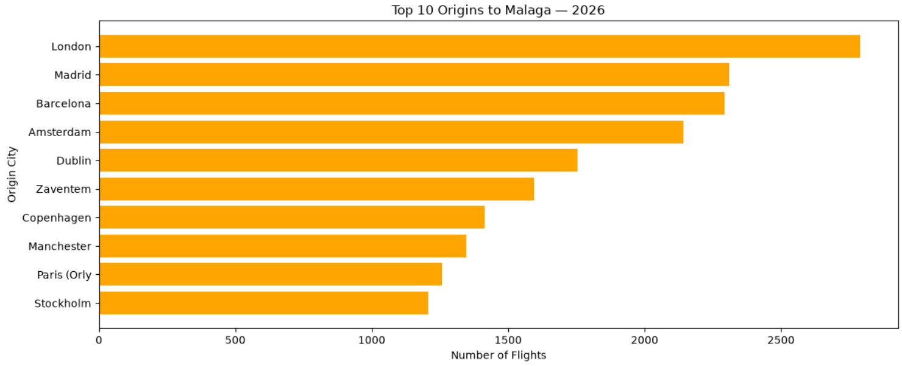
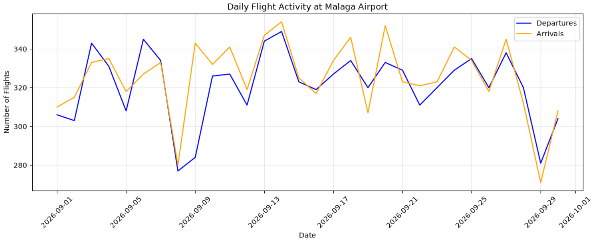

  

<h1 align="center">✈️ Malaga Airport Analytics</h1>

  <strong>Exploring real-world aviation data with Python and Pandas</strong>

  Flight Routes | Airport Traffic | Seasonal Trends

  
  
  
  

A personal **Exploratory Data Analysis (EDA)** project investigating flight activity, routes, origins, and destinations at **Málaga-Costa del Sol Airport (AGP / LEMG)** using real-world aviation data.

## 📊 Project at a Glance

| 🌍 Global Flight Data | ✈️ Málaga Records | 📅 Period |
|:---:|:---:|:---:|
| **~13.5M estimated** | **146,638** | **9 months** |
| Worldwide flights | Málaga-related records | Jan–Sep 2026 |

The project processes large-scale aviation datasets stored in **Parquet format**, filtering worldwide flight records to analyze airport activity in Málaga.

## 🗂️ Data Sources

- **[OpenSky Network](https://opensky-network.org/)** - Worldwide flight records stored in monthly Parquet files, containing millions of observations.
- **[OurAirports](https://ourairports.com/data/)** - Airport names, ICAO codes, countries, and geographical information.

## 📓 Analysis Notebooks

| Notebook | Analysis |
|---|---|
| 📗 [January–September 2026](notebooks/analysis_2026.ipynb) | Extended analysis, monthly trends, route evolution and visualizations |
| 📘 [September 2026](notebooks/analysis_sep2026.ipynb) | Data exploration, flight routes, top destinations and origins |

## 📈 Data Visualization

  

  <em>Top 10 Origin Cities for Flights to Málaga</em>

 

  

  <em>Daily Arrivals and Departures at Málaga Airport</em>

  <em>and more...</em>

## 🔍 Key Findings

- **146,638** Málaga-related flight records analyzed.
- **July:** Highest recorded activity with **22,065 flights**.
- **January:** Lowest recorded activity with **5,803 flights**.
- Recorded flight activity generally increased toward the summer months.

> **Note:** Results reflect available OpenSky records and may not represent all airport operations. Global record volume is estimated, not yet verified.

## 📌 About This Project

Personal project developed while studying **Artificial Intelligence & Big Data**, focusing on Python, Pandas, data processing, and visualization.

 

  <i>Made by</i>
   
  

